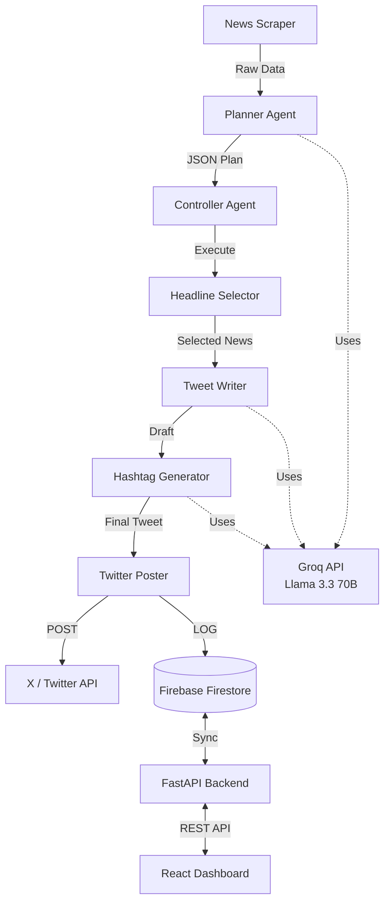

# NEWSIFYX.AI

> **An autonomous AI system that curates global news and broadcasts to X (Twitter) using Groq's lightning-fast LLM API.**


-orange)


## 💡 What is this?
This is a fully automated "digital journalist" that runs 24/7. It uses **Groq API** with **Llama 3.3 70B** to process news, generate engaging tweets, and post them to X (Twitter) autonomously. A **React Dashboard** provides real-time monitoring and remote control via a **FastAPI backend**.

## 🧠 Architecture



## ✨ Key Features

  * **🚀 Fast AI Processing:** Uses **Groq API** with **Llama 3.3 70B Versatile** for lightning-fast LLM inference.
  * **📱 Remote Mission Control:** A **React + Vite** dashboard with real-time monitoring and remote control via FastAPI.
  * **🤖 Autonomous Agent:** Planner-Controller architecture where AI plans and executes its own workflow.
  * **✍️ Context-Aware:** Reads full news summaries to generate accurate tweets and relevant hashtags.
  * **🛡️ Self-Healing:** Comprehensive error handling with automatic retries on network failures or API limits.
  * **📊 Real-Time Dashboard:** Live activity feed, system health monitoring, and manual trigger controls.
  * **🌐 Production Ready:** Deployed on Render with health check endpoints for monitoring services.

## 🚀 Quick Start

### Prerequisites

- Python 3.12+
- Node.js 18+
- Groq API Key ([Get one here](https://console.groq.com/))
- X (Twitter) API credentials
- Firebase project with Firestore enabled

### 1\. Backend (FastAPI + Agent)

```bash
cd autonomous_tweet_agent
python -m venv venv

# Activate virtual environment
# Windows:
venv\Scripts\activate
# Linux/Mac:
source venv/bin/activate

# Install dependencies
pip install -r requirements.txt

# Set up environment variables in .env file:
# GROQ_API_KEY=your_groq_api_key
# X_API_KEY=your_x_api_key
# X_API_SECRET=your_x_api_secret
# X_ACCESS_TOKEN=your_access_token
# X_ACCESS_TOKEN_SECRET=your_access_token_secret

# Place firebase_key.json in autonomous_tweet_agent/ directory

# Run FastAPI server
python -m api.main
# Or with uvicorn directly:
uvicorn api.main:app --host 0.0.0.0 --port 8001 --reload
```

The API will be available at `http://localhost:8001` with interactive docs at `http://localhost:8001/docs`.

### 2\. Frontend (Dashboard)

```bash
cd news-dashboard
npm install

# Create .env file with:
# VITE_API_URL=http://localhost:8001

# Run development server
npm run dev
```

The dashboard will be available at `http://localhost:5173`.

## 📡 API Endpoints

The FastAPI backend exposes the following endpoints:

- `GET /api/health` - Health check (supports GET, POST, HEAD, OPTIONS)
- `GET /api/status` - Get agent status and configuration
- `POST /api/run-agent` - Manually trigger a tweet cycle
- `GET /api/tweets` - Fetch posted tweets (with pagination)
- `GET /api/tweets/by-id/{tweet_id}` - Get a specific tweet by ID
- `GET /api/stats` - Get analytics (tweets today, this week, etc.)
- `PUT /api/config` - Update agent configuration

Visit `/docs` for interactive API documentation.

## 🏗️ Project Structure

```
AI-News-System/
├── autonomous_tweet_agent/     # Backend agent and API
│   ├── api/                    # FastAPI application
│   │   ├── main.py            # FastAPI app entry point
│   │   ├── routes.py          # API endpoints
│   │   ├── services.py        # Agent service logic
│   │   └── models.py          # Pydantic models
│   ├── agents/                 # AI agents
│   │   ├── planner_agent.py   # Plans execution steps
│   │   └── controller_agent.py # Executes the plan
│   ├── tools/                  # Agent tools
│   │   ├── news_scraper_tool.py
│   │   ├── tweet_writer_tool.py
│   │   ├── twitter_poster_tool.py
│   │   └── ...
│   ├── core/                   # Core utilities
│   │   ├── model_adapter.py   # Groq API adapter
│   │   └── db_handler.py      # Firebase operations
│   └── main.py                # Legacy Flask worker (optional)
│
└── news-dashboard/             # React frontend
    ├── src/
    │   ├── components/         # React components
    │   │   ├── TweetFeed.jsx
    │   │   ├── SettingsPanel.jsx
    │   │   └── HowToUse.jsx
    │   ├── services/           # API service layer
    │   │   └── api.js
    │   └── hooks/              # Custom React hooks
    │       └── useApi.js
    └── package.json
```

## 🚢 Deployment

### Backend (Render)

1. Create a new Web Service on Render
2. Connect your GitHub repository
3. Set build command: `pip install -r requirements.txt`
4. Set start command: `uvicorn api.main:app --host 0.0.0.0 --port $PORT`
5. Add environment variables (GROQ_API_KEY, X API keys, Firebase config)
6. Upload `firebase_key.json` as a secret file
7. **Configure Monitoring Service** (to prevent Render from sleeping):
   - **Recommended**: Use `/api/ping` or `/` endpoint (lightweight, avoids rate limits)
   - **Frequency**: Every 10-15 minutes (not every 5 minutes to avoid 429 errors)
   - **Method**: GET or HEAD
   - **Services**: UptimeRobot (free tier: 50 monitors, 5 min intervals), Cronitor, or Render's built-in health checks
   - **Note**: If you get 429 errors, increase the interval to 10-15 minutes or use the `/ping` endpoint

### Frontend (Vercel/Netlify)

1. Connect your GitHub repository
2. Set build command: `npm install && npm run build`
3. Set environment variable: `VITE_API_URL=https://your-backend-url.onrender.com`
4. Deploy!

## 🛠️ Technologies Used

- **Backend**: Python 3.12, FastAPI, Flask (legacy worker)
- **AI**: Groq API with Llama 3.3 70B Versatile
- **Database**: Firebase Firestore
- **Frontend**: React 19, Vite, Lucide React
- **APIs**: X (Twitter) API v2, Google News RSS
- **Deployment**: Render (backend), Vercel/Netlify (frontend)

## 📝 License

This project is open source and available for educational purposes.

---

**Developed by Mehak Saluja**